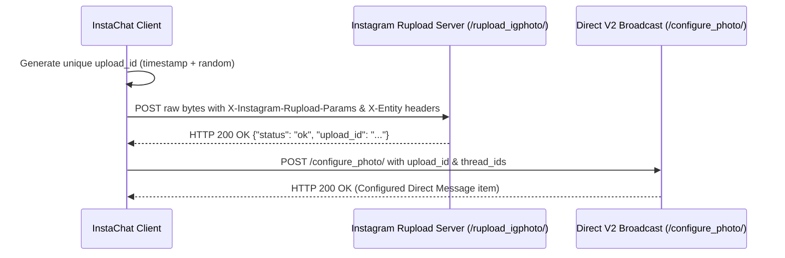

# Instagram Web Direct Messaging Protocol Research

## 1. Overview & Architectural Background

Instagram Web (`https://www.instagram.com`) provides direct messaging (DM) capabilities through an internal private REST/JSON API, internally referred to as `direct_v2`. This interface is used by Instagram's desktop and mobile web client (`web_app`).

Unlike the official Meta Graph API (which is restricted to Instagram Professional / Business / Creator accounts linked to a Facebook Page and webhook endpoints), personal Instagram accounts communicate using internal REST endpoints served from `https://www.instagram.com/api/v1/direct_v2/`.

### Network Architecture
- **API Origin:** `https://www.instagram.com` (primary web frontend) and `https://i.instagram.com` (mobile backend, though web browser requests route through `www.instagram.com`).
- **Resumable Upload Origin:** `https://www.instagram.com/rupload_igphoto/`, `/rupload_igvideo/`, `/rupload_igvoice/`.
- **Payload Format:** 
  - Read endpoints: HTTP GET returning JSON (`application/json`).
  - Write / Broadcast endpoints: HTTP POST with `application/x-www-form-urlencoded` or `multipart/form-data`.
  - Binary media upload: HTTP POST with raw binary streams (`application/octet-stream`) and specialized `X-Instagram-Rupload-Params` headers.
- **Client Identification:** Web requests pass an App ID (`x-ig-app-id: 936619743392459`) and standard browser headers to identify the client as Instagram Desktop Web.

---

## 2. Authentication & Request Headers

### 2.1 Essential Headers
Every request to the `direct_v2` endpoints requires specific HTTP headers to emulate the Instagram Web client and prevent 400/403 rejections:

| Header | Description | Typical Value / Source |
|---|---|---|
| `User-Agent` | Standard desktop browser User-Agent | `Mozilla/5.0 (Windows NT 10.0; Win64; x64) AppleWebKit/537.36 (KHTML, like Gecko) Chrome/126.0.0.0 Safari/537.36` |
| `x-ig-app-id` | Instagram Web App Identifier | `936619743392459` |
| `x-asbd-id` | Meta internal routing & device identifier | `129477` |
| `x-csrftoken` | CSRF Token matching the `csrftoken` cookie | Extracted from active session cookie |
| `x-requested-with` | Indicates AJAX/XHR request | `XMLHttpRequest` |
| `Referer` | Referring page on Instagram | `https://www.instagram.com/direct/inbox/` |
| `Origin` | Request origin | `https://www.instagram.com` |
| `Cookie` | Session cookies string | `sessionid=...; csrftoken=...; ds_user_id=...; mid=...; ig_did=...` |

### 2.2 Security Tokens
- `sessionid`: Meta's primary authentication token. Issued upon successful login and stored in an HTTP-only cookie.
- `csrftoken`: 32-character hexadecimal string or alphanumeric token generated by Instagram. Transmitted in both the `Cookie` header and the `x-csrftoken` header, and included in POST form bodies as `_csrftoken`.
- `ds_user_id`: The numeric user ID of the authenticated user.
- `client_context`: Client-generated UUIDv4 (or timestamp-based UUID) included in mutation requests (message sends, reactions) to provide idempotency and deduplication on Meta's server clusters.

---

## 3. Discovered Endpoints & Protocol Specifications

### 3.1 Inbox & Conversation Discovery

#### Endpoint: Get Inbox (Conversations List)
- **Method:** `GET`
- **URL:** `https://www.instagram.com/api/v1/direct_v2/inbox/`
- **Query Parameters:**
  - `visual_message_return_type`: `unseen`
  - `thread_message_limit`: Number of preview messages per thread (default: `10` or `20`)
  - `persistentBadging`: `true`
  - `limit`: Number of threads to return (default: `20`, max: `20`)
  - `cursor`: (Optional) Thread cursor for fetching older conversations
- **Response Structure (JSON):**
  ```json
  {
    "inbox": {
      "threads": [
        {
          "thread_id": "340282366841710300949128123456789012345",
          "thread_v2_id": "17841400000000000",
          "users": [
            {
              "pk": "1234567890",
              "username": "janedoe",
              "full_name": "Jane Doe",
              "profile_pic_url": "https://scontent...",
              "is_verified": false
            }
          ],
          "thread_title": "janedoe",
          "is_group": false,
          "muted": false,
          "last_activity_at": 1729500000000000,
          "items": [
            {
              "item_id": "340282366841710300949128123456789012345",
              "user_id": 1234567890,
              "timestamp": 1729500000000000,
              "item_type": "text",
              "text": "Hey there!"
            }
          ],
          "read_state": 0
        }
      ],
      "has_older": true,
      "oldest_cursor": "2849581903485093845",
      "unseen_count": 1
    },
    "status": "ok"
  }
  ```

#### Endpoint: Get Thread History
- **Method:** `GET`
- **URL:** `https://www.instagram.com/api/v1/direct_v2/threads/{thread_id}/`
- **Query Parameters:**
  - `cursor`: (Optional) Message cursor for paginating older messages in the thread
  - `direction`: `older`
- **Response Structure (JSON):**
  ```json
  {
    "thread": {
      "thread_id": "340282366841710300949128123456789012345",
      "users": [...],
      "items": [
        {
          "item_id": "3100000000000000001",
          "user_id": 9876543210,
          "timestamp": 1729500010000000,
          "item_type": "text",
          "text": "Hello!",
          "reactions": {
            "likes": [
              {
                "sender_id": 1234567890,
                "timestamp": 1729500015000000
              }
            ],
            "emojis": [
              {
                "sender_id": 1234567890,
                "emoji": "🔥",
                "timestamp": 1729500016000000
              }
            ]
          }
        }
      ],
      "has_older": true,
      "oldest_cursor": "3100000000000000001"
    },
    "status": "ok"
  }
  ```

---

### 3.2 Message Operations

#### Endpoint: Broadcast Text Message
- **Method:** `POST`
- **URL:** `https://www.instagram.com/api/v1/direct_v2/threads/broadcast/text/`
- **Content-Type:** `application/x-www-form-urlencoded`
- **Form Body Parameters:**
  - `thread_ids`: JSON string array of target thread IDs, e.g., `["340282366841710300949128123456789012345"]`
  - `text`: String content of the message
  - `client_context`: Unique UUIDv4 (deduplication key)
  - `_csrftoken`: Session CSRF token
  - `_uuid`: Device UUID or session UUID
  - `action`: `send_item`
  - *(Optional for reply)*: `replied_to_item_id`: Target message `item_id`
  - *(Optional for reply)*: `replied_to_client_context`: Target message client context
- **Success Response:**
  ```json
  {
    "status": "ok",
    "item_id": "3100000000000000002",
    "timestamp": 1729500020000000,
    "thread_id": "340282366841710300949128123456789012345"
  }
  ```

#### Endpoint: Send Reaction (Emoji / Like)
- **Method:** `POST`
- **URL:** `https://www.instagram.com/api/v1/direct_v2/threads/broadcast/reaction/`
- **Content-Type:** `application/x-www-form-urlencoded`
- **Form Body Parameters:**
  - `thread_id`: Target thread ID
  - `item_id`: Target message ID
  - `reaction_type`: `like` or `emoji`
  - `reaction_emoji`: Emoji character (e.g. `❤️`, `👍`, `😂`) when `reaction_type` is emoji
  - `client_context`: UUIDv4
  - `_csrftoken`: CSRF token
  - `_uuid`: Device UUID
- **Alternative URL:** `https://www.instagram.com/api/v1/direct_v2/threads/{thread_id}/items/{item_id}/send_reaction/`

#### Endpoint: Delete / Remove Reaction
- **Method:** `POST`
- **URL:** `https://www.instagram.com/api/v1/direct_v2/threads/{thread_id}/items/{item_id}/delete_reaction/`
- **Form Body:** `client_context`, `_csrftoken`

#### Endpoint: Unsend Message (Delete)
- **Method:** `POST`
- **URL:** `https://www.instagram.com/api/v1/direct_v2/threads/{thread_id}/items/{item_id}/delete/`
- **Content-Type:** `application/x-www-form-urlencoded`
- **Form Body Parameters:**
  - `client_context`: UUIDv4
  - `_csrftoken`: CSRF token
- **Success Response:**
  ```json
  {
    "status": "ok"
  }
  ```

#### Endpoint: Mark Seen (Read Receipt)
- **Method:** `POST`
- **URL:** `https://www.instagram.com/api/v1/direct_v2/threads/{thread_id}/items/{item_id}/seen/`
- **Content-Type:** `application/x-www-form-urlencoded`
- **Form Body Parameters:**
  - `_csrftoken`: CSRF token
  - `use_unified_inbox`: `true`

#### Endpoint: Activity Status (Typing Indicator)
- **Method:** `POST`
- **URL:** `https://www.instagram.com/api/v1/direct_v2/threads/{thread_id}/activity_status_update/`
- **Form Body Parameters:**
  - `activity_status`: `1` (typing) or `0` (stopped typing)
  - `_csrftoken`: CSRF token

#### Endpoint: Set Chat Theme
- **Method:** `POST`
- **URL:** `https://www.instagram.com/api/v1/direct_v2/threads/{thread_id}/set_theme/`
- **Form Body Parameters:**
  - `theme_id`: Numeric/string theme identifier (e.g., `default`, `maple`, `lavender`, `monochrome`, or numeric ID)
  - `_csrftoken`: CSRF token

---

### 3.3 Media Upload Protocol (Rupload Architecture)

Media upload on Instagram Web requires a multi-stage resumable protocol:



1. **Step 1: Upload raw binary to Rupload endpoint:**
   - **URL:** `https://www.instagram.com/rupload_igphoto/{upload_id}` (for images)
   - **URL:** `https://www.instagram.com/rupload_igvideo/{upload_id}` (for videos)
   - **URL:** `https://www.instagram.com/rupload_igvoice/{upload_id}` (for audio/voice)
   - **Headers:**
     - `X-Entity-Type`: `image/jpeg` (or `video/mp4`, `audio/mp4`, `audio/aac`)
     - `X-Entity-Name`: `direct_photo_${upload_id}.jpg`
     - `X-Entity-Length`: `<buffer_length>`
     - `Offset`: `0`
     - `X-Instagram-Rupload-Params`: JSON string:
       ```json
       {
         "upload_id": "1729500030000",
         "media_type": 1,
         "upload_media_height": 1080,
         "upload_media_width": 1080
       }
       ```
     - `Content-Type`: `application/octet-stream`
   - **Body:** Raw file binary buffer

2. **Step 2: Broadcast / Configure:**
   - **Endpoint:** `https://www.instagram.com/api/v1/direct_v2/threads/broadcast/configure_photo/` (or `configure_video/`)
   - **Form Body:**
     - `upload_id`: The ID used in Step 1
     - `thread_ids`: `["<thread_id>"]`
     - `client_context`: Unique UUIDv4
     - `_csrftoken`: CSRF token

---

## 4. Realtime vs Polling Protocol Evaluation

### 4.1 Meta's MQTT-over-WebSockets (WSS)
Instagram Web connects to `wss://edge-chat.instagram.com/chat` using MQTT encapsulated in binary Thrift serialization.
- **Protocol:** MQTT v3.1.1 with Facebook-specific compact thrift payloads (`/ig_message_sync`, `/ig_realtime_sub`).
- **Observed Stability:** Very brittle when consumed outside the proprietary Facebook JS bundle. Meta frequently alters packet headers, compression dictionaries (Zstandard/Deflate), and encryption handshakes.
- **Maintenance Cost:** High risk of abrupt protocol failure.

### 4.2 Adaptive Polling (Recommended for Unofficial Production Library)
- **Mechanism:** Periodically querying `/api/v1/direct_v2/inbox/?visual_message_return_type=unseen` or individual active threads.
- **Reliability:** 100% reliable across all standard web sessions; mirrors normal browser tab activity.
- **Deduplication:** Maintained via a client-side sliding window of seen `item_id`s and `timestamp` high-water marks.
- **Adaptive Backoff:** Configurable interval (default 3,000ms), backing off upon idle periods or HTTP 429 rate limiting.
